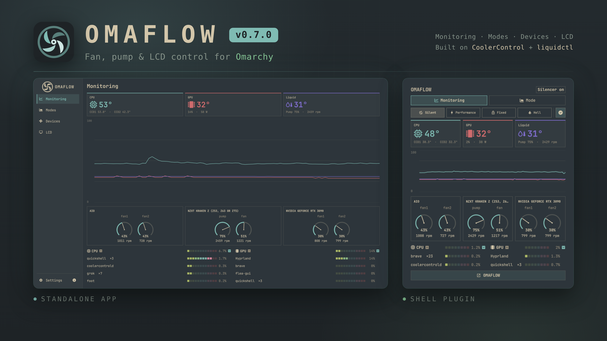
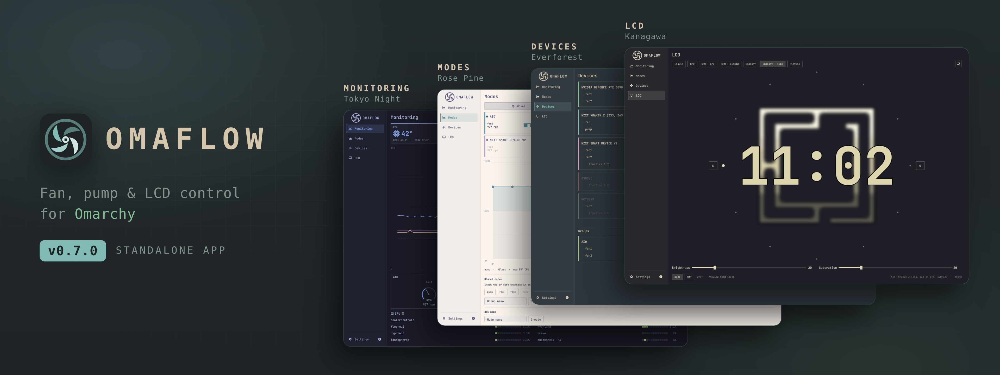
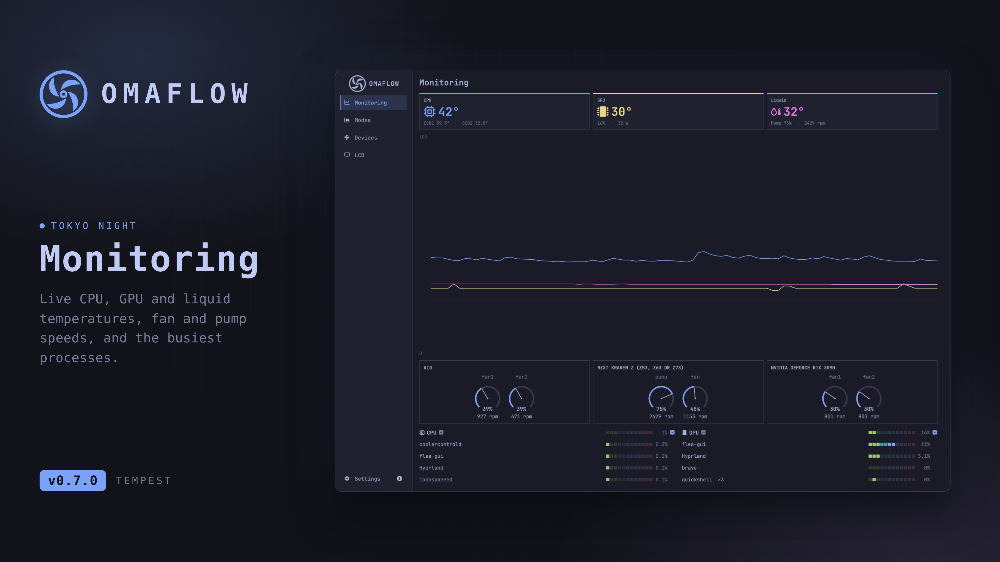
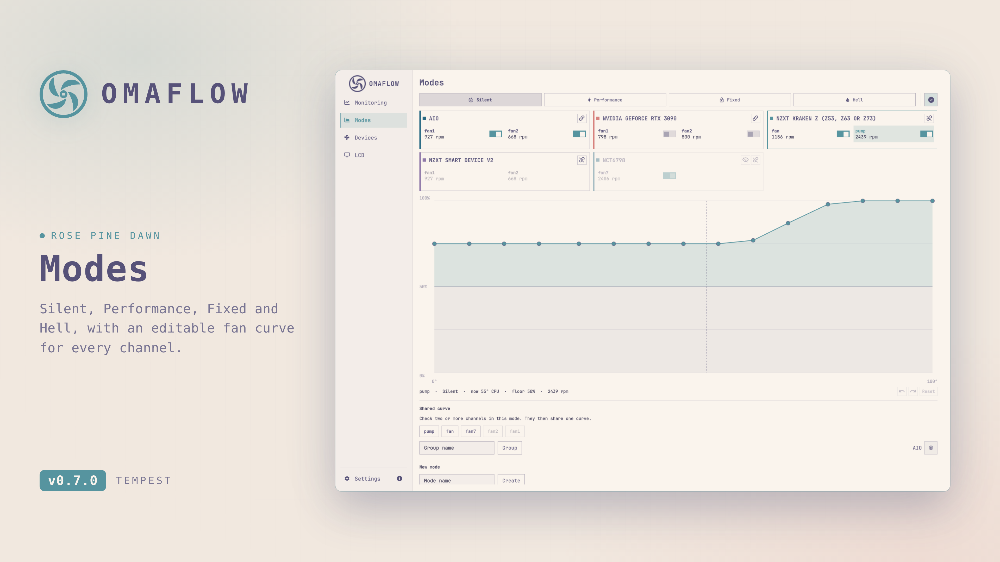
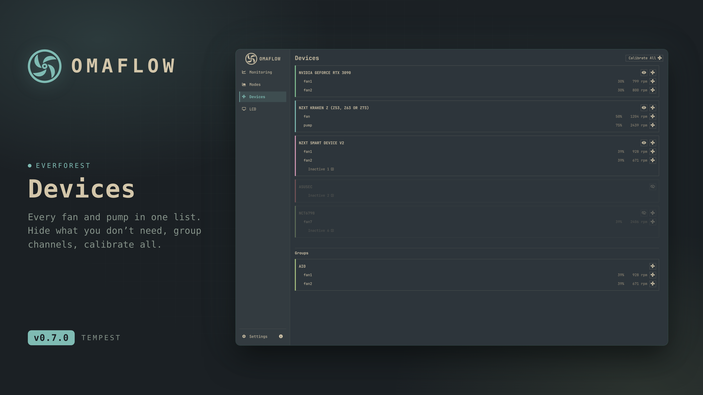
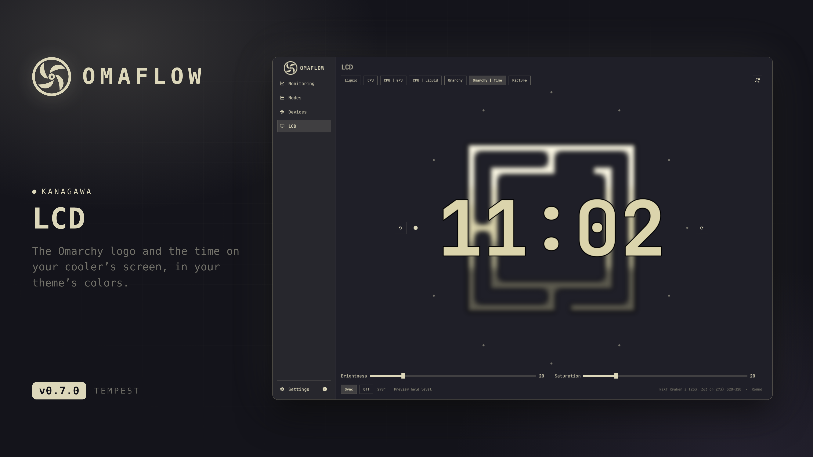
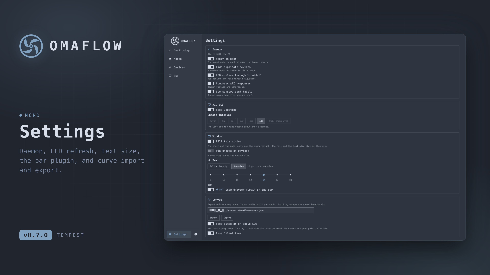
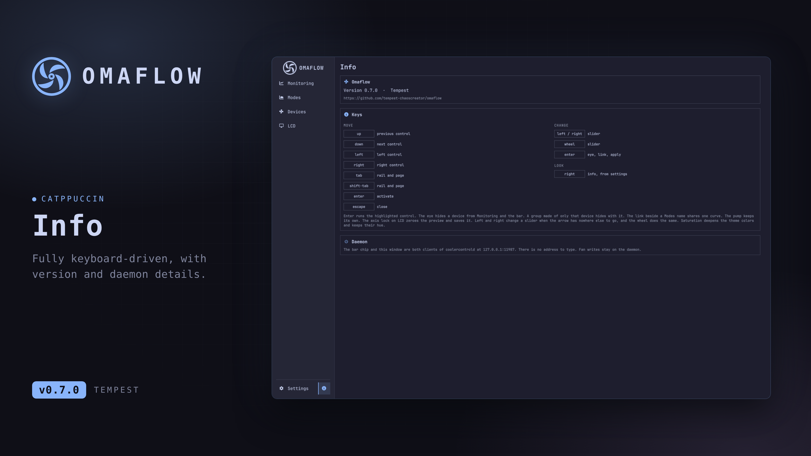
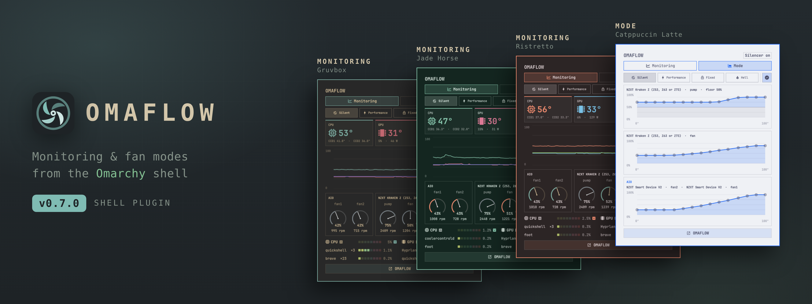

# Omaflow

Omaflow 0.7 is the cooling window and the Omarchy bar chip. Both are clients of [CoolerControl](https://gitlab.com/coolercontrol/coolercontrol)'s `coolercontrold` at `127.0.0.1:11987`. Open the chip and choose **Install coolercontrold** or **Start coolercontrold** after you approve it, or install and start the daemon yourself. **Start with the PC** stays off until you turn it on. Fan writes and sensor polls stay on that daemon's `poll_rate`. Omaflow does not read sysfs, does not run `liquidctl`, does not install the CoolerControl desktop package, and does not store the CoolerControl password.



## Install

### Plugin

The bar chip is this repository. `omarchy plugin add` clones it to:

`~/.config/omarchy/plugins/tempest-chaoscreator.omaflow/`

```bash
omarchy plugin add https://github.com/tempest-chaoscreator/omaflow.git --enable
```

The first time the chip loads, it copies the window launcher into place. `omarchy plugin update` refreshes that copy the next time the chip loads.

- `~/.local/bin/omaflow` opens it.
- `~/.local/share/omaflow/` holds the window files.
- `~/.local/share/applications/omaflow-standalone.desktop` is the launcher entry.
- `~/.config/omaflow/` holds the token and the other settings, written by the running program.

That copy does not install `coolercontrold`. Open the chip. If `coolercontrold` is missing, choose **Install coolercontrold**. That asks for your password and runs `omarchy pkg aur add coolercontrold`. It does not install the CoolerControl desktop package. If the package is already installed and the service is stopped, choose **Start coolercontrold**. That asks for your password and runs `systemctl start`. It does not enable the service at boot, and Omaflow does not run as root.

To start the daemon with the PC, open Omaflow and turn on **Start with the PC** in Settings. That stays off until you turn it on. The same two steps from a terminal:

```bash
omarchy pkg aur add coolercontrold
sudo systemctl enable --now coolercontrold
```

Update the installed chip with:

```bash
omarchy plugin update tempest-chaoscreator.omaflow
```

### Git clone

Use this to publish the same launcher from a source checkout. The plugin command above already does that copy when the chip loads. `./install` does not replace the bar checkout, does not install `coolercontrold`, does not enable the daemon, and does not touch fan settings. The window offers the same Install and Start buttons as the chip.

```bash
git clone https://github.com/tempest-chaoscreator/omaflow.git
cd omaflow
./install
omaflow
```

Install and start the daemon from those buttons, or from a terminal. Install runs `omarchy pkg aur add coolercontrold` and does not install the CoolerControl desktop package. Start runs `systemctl start` and does not enable the service at boot. **Start with the PC** in Settings stays off until you turn it on.

```bash
omarchy pkg aur add coolercontrold
sudo systemctl enable --now coolercontrold
```

A saved token at `~/.config/omaflow/coolercontrol.token` (mode `0600`) connects with no prompt. The password is asked once, used to create the token, and dropped. A changed CoolerControl password is left alone. The password and the token are sent only after the listener on `127.0.0.1:11987` is identified as the `coolercontrold` service. If that check fails, nothing is sent. Authenticated requests are not followed across redirects.

When the daemon has no modes, Omaflow creates Silent, Performance, Fixed, and Hell. Each mode gets its own fan curve and its own pump curve. Pump duty stays at or above 50% until that floor is turned off in Settings. Silent is left running. A daemon that already has modes is not rewritten.

### Remove

```bash
omarchy plugin remove tempest-chaoscreator.omaflow
rm -f ~/.local/bin/omaflow ~/.local/share/applications/omaflow-standalone.desktop
rm -rf ~/.local/share/omaflow
```

That removes the chip and the window launcher. `coolercontrold` stays installed. The token file stays until you delete `~/.config/omaflow/coolercontrol.token`.

## Dependencies

- Omarchy, for the bar and Quickshell
- `coolercontrold`, not the CoolerControl desktop package
- Python 3, which Omarchy already provides
- `python-pillow`, for the pictures sent to an AIO LCD

## The window





**Monitoring.** Temps, fan speeds, and which apps are using the CPU and GPU. The CPU percent is that app's share of the machine. The GPU percent is that app's share of the GPU's load. The chart is the last minute. Empty headers that report a duty and 0 rpm stay hidden. GPU fans stay visible at 0 rpm. The window lists four apps on each side. The chip lists two.



**Modes.** Pick a mode, shape each fan's curve, and link channels. Silent, Performance, Fixed, Hell, or a mode you add. Each mode keeps its own curves. A link shares one curve across the fans on that card. The pump keeps its own. Drag a handle to edit. Undo, redo, and Reset sit under the graph. Apply is the check on the right. Choosing a mode does not run it. Apply waits while a fan is being calibrated.



**Devices.** See every fan. Calibrate one, a group, or all. The eye hides a device from Monitoring and the bar. Hidden devices stay at the bottom. Custom groups sit below them until **Pin groups** is on, with a line between the two lists. Calibrate follows the daemon's own sweep, one fan at a time, and does not rewrite saved modes.



**LCD.** Choose what the cooler's LCD shows, including the Omarchy logo and a picture from your home directory. The faces are Liquid, CPU, CPU | GPU, CPU | Liquid, Omarchy, Omarchy | Time, and Picture. Round or square follows the cooler. Brightness and saturation sit on the page. Omarchy | Time draws the clock in the theme accent with a 1px black edge. Picture stays centered, and it can be larger or smaller. The cooler keeps the last picture it was sent. Picture mode does not refresh on a timer. Settings can keep the other faces updating while the window is closed, as long as the bar plugin is enabled. Never leaves that picture in place. With no supported AIO LCD, the page says so and the controls under it stay dimmed.



**Settings.** Set LCD updates, window fill, alerts, and export or import curves. **Pin groups** puts custom groups at the top of Devices. Fill gives spare height to the graphs. Text size can follow Omarchy or stay at a chosen size. Export and import write `~/Documents/omaflow-curves.json`. The pump floor and a slower Silent fan pace are switches here. CPU, GPU, and coolant alerts stay off until you turn one on. The bar switch installs this repository when the chip is missing.



**Info.** Every key, and the version you are on. Enter runs the highlighted control. Escape closes the window.

## The bar plugin



Left click opens the chip. Monitoring shows CPU, GPU, liquid when the cooler reports it, the fans, and which apps are using the CPU and GPU. Mode shows the curves for the selected mode. `1`–`9` select a mode. Apply runs it. `o` opens the window. Escape closes the popover.

## Commands

The bar chip answers `omarchy-shell omaflow <command>`. Each command takes no arguments. An action prints `ok`, or one line when it cannot run. A status command prints one line. A deck key can call any of these later.

- `silent`, `performance`, `fixed`, and `hell` run those modes.
- `custom` runs the one mode besides those four.
- `lcdLiquid`, `lcdCpu`, `lcdCpuGpu`, `lcdCpuLiquid`, `lcdOmarchy`, `lcdOmarchyTime`, and `lcdPicture` show that face on the AIO LCD.
- `lcdOff` turns the AIO LCD off and keeps the saved face.
- `mode` prints the running mode.
- `lcd` prints the face on the AIO LCD, or `LCD off`.
- `temp` prints the hottest temperature.
- `pump` prints pump duty and speed.
- `alerts` prints the active alerts.

## Coolers

Anything `coolercontrold` lists from liquidctl or hwmon. The pump floor is 50% in every mode until it is turned off in Settings, which asks for your password and does not store it.

- NZXT Kraken Z, X, and 2023/2024, including an AIO LCD when the device has one
- NZXT Smart Device fan hubs
- Corsair Hydro and Commander hubs that liquidctl exposes
- MSI MEG/MPG CoreLiquid, EVGA and NZXT Asetek 690LC, Aquacomputer D5 Next
- Motherboard PWM headers and NVIDIA GPU fans that CoolerControl exposes

## License

[MIT](LICENSE)
